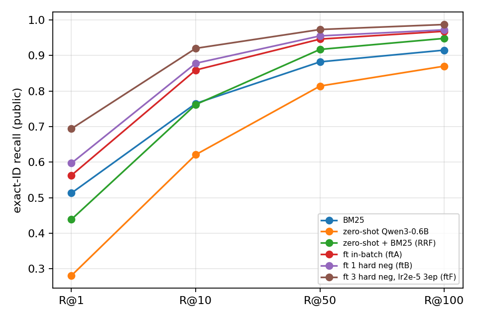
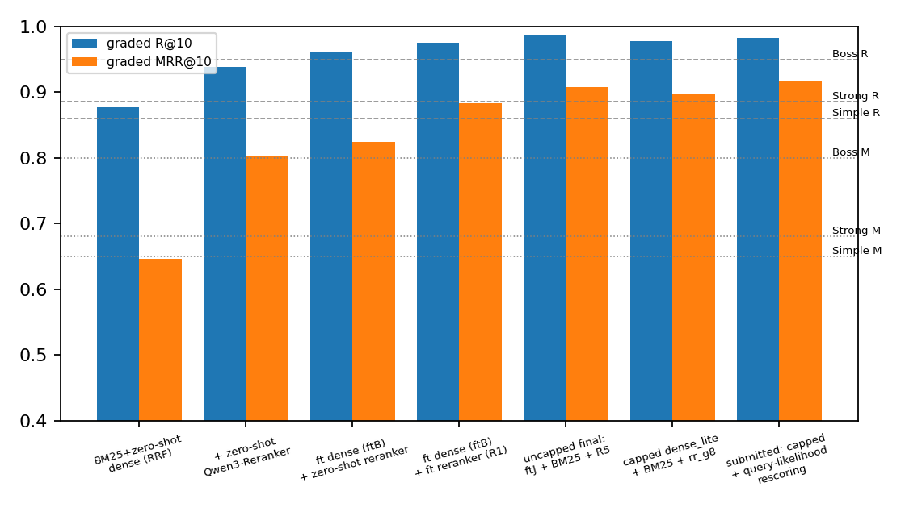
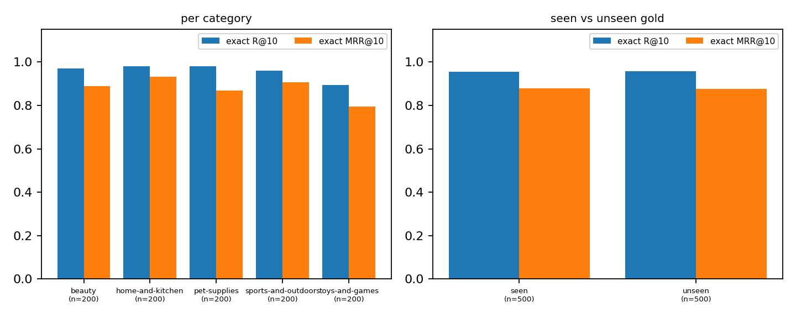

Code and logs: <https://github.com/goog-msft-fb-nflx-nvda-aapl/csie5431-adl-hw2> (private until after the
deadline, made public afterwards; `docs/WORKLOG.md` there is the full experiment log).

All numbers are on the public split (1,000 dialogues, 75,000 products) unless stated. "Graded" = the TA's
`evaluate.py` (gold or judge-accepted alternative counts, judge Qwen2.5-1.5B-Instruct); "exact" = gold ID
only. Timings are from a shared NVIDIA H200; **no RTX 3070 was available, so 3070 speed was not measured.**
Hyperparameters were chosen using public metrics (see Limitations).

# Q1. Retrieval and reranking strategy

## Submitted pipeline

1. **Dense retrieval.** Qwen3-Embedding-0.6B fine-tuned on the training dialogues. The query is the TA's
   all-turn text (role-tagged turns, as built by `build_eval_query`) with the model's own query
   instruction prompt; products are `title\ndescription`, truncated to 512 tokens.
2. **BM25** (scikit-learn CountVectorizer, English stop words, k1 1.2, b 0.75) over the same text.
3. **Fusion**: reciprocal rank fusion (k = 60) of the two top-200 lists.
4. **Rerank** the top 30 with Qwen3-Reranker-0.6B fine-tuned (score = logit("yes") - logit("no") at the last
   position, fp16, 1,800 characters of product text per candidate), return the top 10.
5. A wall-clock guard shrinks the dense max length and the rerank depth if the measured speed projects past
   a 3,000 s budget, so a slower GPU degrades quality instead of exceeding the one-hour limit.

## Training data construction

No external dataset is used; the only extra supervision is produced by the provided judge model.

*Dense retriever.* Anchor = conversation text; positive = the gold product text; negatives = the other
positives in the batch (batch 128) plus **7 mined hard negatives per query**, sampled uniformly from ranks
5-50 of the zero-shot BM25 + Qwen3-Embedding hybrid ranking, excluding the gold and any product with the same
title as the gold (colour/size variants). Skipping ranks 1-4 is a precaution against false negatives
(acceptable alternatives would count as correct at test time). 4,830 training dialogues (all of them for the
submitted model).

*Reranker.* For each training dialogue the top-20 zero-shot hybrid candidates were judged with the official
judge (gold as reference), 93,197 judgments: 8.1% of non-gold candidates were accepted and 54.3% of dialogues
have at least one accepted alternative in their top 20. A training group is 1 positive + 15 negatives:
the positive is the gold, or with probability 0.5 a random judge-accepted alternative (when one exists);
negatives are sampled from the judge-rejected candidates. This keeps probable false negatives out of the
negatives and teaches the reranker the same notion of relevance the metric uses.

## Loss and hyperparameters

* Dense: `CachedMultipleNegativesRankingLoss` (InfoNCE over cosine similarity, scale 20, i.e. temperature
  0.05, in-batch + hard negatives, GradCache mini-batch 32), batch 128, lr 3e-5, 4 epochs, linear decay with 10%
  warm-up, bf16, max length 512, `NO_DUPLICATES` batch sampler. 4 epochs x 38 steps on 1 H200.
* Reranker: listwise softmax cross-entropy over the 16 scores of a group with the positive as target, full
  fine-tune, AdamW lr 2e-5, 2 dialogues (32 sequences) per step, 1 epoch (2,415 steps), linear decay with 10%
  warm-up, bf16, gradient checkpointing, max length 1,024, 1,800 characters per product.
* Base models: `Qwen/Qwen3-Embedding-0.6B`, `Qwen/Qwen3-Reranker-0.6B`.

## Strategies tried and why the submitted one is best

Exact-ID R@10 / MRR@10 unless marked graded. Single runs unless a spread is given; measured seed spread was about
0.004 (R@10) and 0.008 (MRR@10) for the settings that were repeated with 3 seeds.

| # | strategy | R@10 | MRR@10 |
|---|---|---|---|
| 1 | BM25 | 0.765 | 0.595 |
| 2 | zero-shot dense: bge-base / Qwen3-Emb-0.6B / bge-m3 / BLaIR-base / BLaIR-large | 0.556 / 0.621 / 0.473 / 0.487 / 0.229 | 0.335 / 0.381 / 0.279 / 0.273 / 0.127 |
| 3 | zero-shot dense + BM25 (RRF) | bge-base 0.724, Qwen3 0.762, bge-m3 0.694 | 0.498, 0.537, 0.462 |
| 4 | #3 (Qwen3) + zero-shot reranker, top 30: MiniLM-L6 / bge-reranker-v2-m3 / Qwen2.5-1.5B (my judge-style prompt, top 20) / Qwen3-Reranker-0.6B | 0.574 / 0.653 / 0.701 / 0.873 | 0.296 / 0.383 / 0.380 / 0.717 |
| 5 | fine-tuned dense, in-batch only | 0.859 (dense) | 0.666 |
| 6 | + 1 hard negative; 3; 7 (lr 3e-5, 4 ep) | 0.878; 0.885; 0.932 (dense) | 0.694; 0.713; 0.797 |
| 7 | #6 (1 hard neg) + BM25 + zero-shot Qwen3-Reranker | 0.920 | 0.745 |
| 8 | #7 with fine-tuned reranker (gold positive; or p = 0.5 alternatives; 16-group lr 2e-5) | 0.938; 0.938; 0.940 | 0.835; 0.843; 0.857 |

Judge-graded R@10 / MRR@10 of full pipelines: zero-shot hybrid 0.877 / 0.646; + zero-shot Qwen3-Reranker 0.938 /
0.803; fine-tuned dense (1 negative) + zero-shot reranker 0.960 / 0.824; same + fine-tuned reranker 0.975 / 0.883;
ftF dense (3 negatives) + BM25 + R2 reranker (both trained on all data) 0.977 / 0.887; **submitted pipeline
0.986 / 0.908** (spec thresholds on public: Simple 0.860 / 0.650, Strong 0.885 / 0.680, Boss 0.950 / 0.800).
Private metrics cannot be measured here.

{width=55%}

{width=62%}

Why the submitted pipeline: (a) the zero-shot dense models were all below BM25 at R@10, so lexical matching and
fine-tuning both matter; fine-tuning the dense retriever on the 4,830 dialogues raised dense R@10 from 0.621 to
0.859 with in-batch negatives and to 0.932 with 7 mined negatives and a longer schedule. (b) Of the zero-shot
rerankers only Qwen3-Reranker-0.6B improved the ranking (the other three lowered both exact metrics and, for
MiniLM and bge-reranker, the graded ones: 0.740 / 0.410 and 0.791 / 0.494); fine-tuning it with
judge-labelled negatives took exact MRR@10 on the same shortlist from 0.745 to about 0.84-0.86. (c) BM25
fusion helped in the final configuration (graded 0.977 / 0.887 with, 0.969 / 0.873 without, for the ftF + R2 pair),
but not in every dense-only comparison (for the strongest dense models, R@10 / MRR@10 was equal or lower with
fusion while R@100 was higher). BLaIR (pretrained on Amazon Reviews 2023, likely overlapping this benchmark's
products) was only run zero-shot as a disclosed ablation and is not used.

## Ablations and analyses

* **Rerank depth** (zero-shot shortlist, Qwen3-Reranker zero-shot, exact R@10 / MRR@10): depth 10 0.762 / 0.662,
  20 0.837 / 0.700, 30 0.873 / 0.717, 50 0.886 / 0.723. First-stage exact recall@30 / @100 of the zero-shot hybrid was
  0.892 / 0.948.
* **Product text per candidate at rerank time** (depth 30): 600 / 1,000 / 1,400 / 1,800 characters gave
  MRR@10 0.622 / 0.697 / 0.717 / 0.717.
* **Dense max length at inference** (ftD): 256 / 384 / 512 tokens gave dense R@10 0.894 / 0.907 / 0.912; end to end
  (graded R@10 / MRR@10) 256 tokens + depth 20 + 1,200 characters 0.970 / 0.880 in 226 s versus 512 / 30 / 1,800
  0.977 / 0.891 in 412 s (ftD + R2 models).
* **Seen vs unseen gold** (final pipeline, exact R@10 / MRR@10): seen-in-train-pool targets (500) 0.972 / 0.868,
  never-seen targets (500) 0.958 / 0.870. Earlier systems also showed seen and unseen within about 2 points at R@10.
* **Per category** (200 queries each, exact R@10 / MRR@10): beauty 0.970 / 0.880, home & kitchen 0.985 / 0.923,
  pet supplies 0.985 / 0.848, sports & outdoors 0.965 / 0.899, toys & games 0.920 / 0.796.

{width=80%}

## Resources

On the H200 (shared): `retrieval.py` 451 s (dense stage including BM25 281 s, rerank 168 s), peak allocated
GPU memory 3.45 GB. `evaluate.py` (judge, the TA's script) peaked at 17 GB reserved with batch size 16 on the H200 and 8.4 GB
reserved with batch size 8, so the judge's memory depends on its batch size and is larger than our pipeline's. Estimate for a 3070 (interpretation, not measured): about
25-45 minutes from FLOP counting, which is why the time guard exists; in a simulated 500 s budget the guard
chose 256 tokens and depth about 4 and still scored 0.950 / 0.855 graded.

# Q2. Generation analysis

Qwen2.5-1.5B-Instruct (bf16, greedy, 220 new tokens) answered 10 random public dialogues from the final
pipeline's top 3 retrieved specs (700 characters each) under three prompts: **plain** (one-line system prompt,
"write the assistant's next reply recommending a product"), **grounded** (recommend one product from the list,
only facts present in the spec, mention the title and 2-3 matching features, under 80 words) and **checklist**
(first list the user's firm requirements, then pick one candidate quoting its spec, then a "Not confirmed" line).
The gold product was the rank-1 retrieved item in 9 of 10 dialogues. Outputs are in `results/q2_final.jsonl`.

| prompt | mean words | names the rank-1 title | invented URL | "Not confirmed: None ..." |
|---|---|---|---|---|
| plain | 96 | 8/10 | 1 | - |
| grounded | 56 | 8/10 | 1 | - |
| checklist | 69 | 7/10 | 0 | 4 |

Qualitative findings (10 samples, counts are of surface features, not a hallucination rate):

1. *No-lamp French nails (beauty-000138).* plain ignored the rank-1 acrylic powder and recommended another
   candidate (nail tips) with details from that candidate's spec, i.e. it did not follow the best-first order;
   grounded and checklist recommended the retrieved top item.
2. *Deodorant stick (beauty-000065, gold at rank 2).* all three recommended the rank-1 Speed Stick, so a
   retrieval error flows straight into the answer; grounded also fabricated a link and a variant name
   ("Pack of 2") not in the specs, and checklist listed requirements the user never stated ("Cleanser",
   "Aluminum-free").
3. *Shaped St. Patrick's puzzle (toys-000068).* checklist wrote "Standard rectangular shape" under the
   requirements even though the user asked for a shaped puzzle; plain and grounded were correct and grounded
   correctly added the spec's age range.
4. *Hidden handgun mount (sports-000180).* checklist's "Not confirmed" line said the spec does not mention
   discreet mounting although the product title is "Concealed Holder", so the verification step was wrong.
5. *Whitefish cat food (pet-supplies-000108) and tablecloth clips (home-000062).* all prompts were accurate; the
   plain prompt added unsupported flourishes (a product URL and "trusted since 2017" for the cat food).

Interpretation (not measured beyond these samples): the short grounded prompt gave the most concise answers
that stayed on spec-stated features; the checklist prompt produced structure but its verification step was
empty or wrong in most samples and sometimes invented requirements; the plain prompt was longest and added the
most unsupported detail. No human or judge faithfulness rating was done.

# Limitations

Hyperparameters were selected using public-set metrics, so public numbers are optimistic for the chosen
configuration; no separate dev score was computed (a product-disjoint dev split was held out for the
non-final models but not scored). The private test pool is larger (100,000 products). Most comparisons are single
runs; the measured seed spread is given above. The 3070 run time is estimated, not measured.
